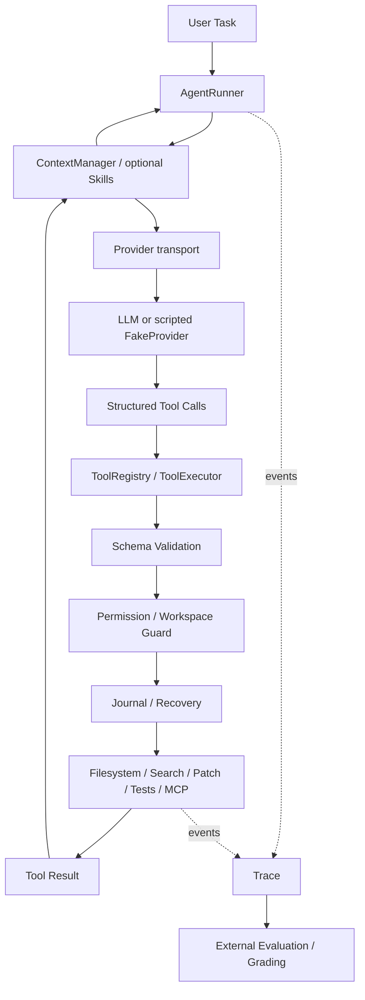

# Lightweight Coding Agent Harness

[](https://github.com/tyh545259216-source/lightweight-coding-agent-harness/actions/workflows/ci.yml)

A lightweight Coding Agent execution framework with an independently implemented Agent Runtime.

轻量级 Coding Agent 执行框架（自研 Agent Runtime）

- **Agent Runtime built from scratch** — bounded asynchronous orchestration, without an imported agent-loop framework.
- **Structured Tool Calling and unified Tool Registry** — strict schemas and one execution path for local and adapted MCP tools.
- **Context / Permission / Recovery reliability mechanisms** — bounded requests, explicit grants and durable execution records.
- **Trace-driven evaluation and failure analysis** — separate model outcomes from runtime safeguards.



## Why this project?

A tool-calling application needs execution rules when the model supplies invalid arguments, guesses paths, expands context, stops early, encounters a tool failure or is interrupted during a write. This project implements and tests those rules in a small runtime whose control flow can be read end to end.

Coding is the main experimental workload. The engineering goal is to understand Agent Runtime design; model training and claims of reliable autonomous coding are outside the demonstrated results.

## Quick start — no model required

Python 3.12+; commands run from the repository root.

```sh
python -m venv .venv
# Windows PowerShell: .venv\Scripts\Activate.ps1
# macOS/Linux: source .venv/bin/activate
python -m pip install -r requirements-lock.txt
python -m pip install --no-deps --no-build-isolation -e .
python examples/tutorial_demo.py
python examples/tutorial_demo.py --demo navigation
python examples/mcp_demo.py
```

The tutorials use a **scripted FakeProvider** with real filesystem edits, protected tests and real pytest execution. They demonstrate runtime mechanics, not model intelligence, and are **not part of benchmark scores**. Each run creates a fresh directory under ignored `work/`.

Optional local-model tutorial, with an already installed Ollama model:

```sh
python examples/tutorial_ollama.py --model qwen3:1.7b
```

Live behavior is model-dependent / best effort. The command does not download models and does not retry whole attempts until success. See the [demo walkthrough](docs/DEMO_WALKTHROUGH.md).

## Core features

1. **Agent loop and providers.** The runner bounds rounds and wall-clock time; providers transport messages and structured decisions.
2. **Registry and executor.** One registry exposes tool schemas; one executor validates calls, applies policy and records outcomes.
3. **Context management.** Byte-budget request construction preserves complete call/result groups; source and test evidence can be pinned.
4. **Permission and workspace guard.** Read/write/execute grants are explicit; file paths are resolved inside the workspace and protected files reject edits.
5. **Sessions and recovery.** Append-only execution records support completed-result reuse and block uncertain side-effect replay.
6. **Coding tools and verification.** Bounded navigation, observed reads, preconditioned patches and configurable completion checks expose auditable evidence.
7. **Optional Skills and MCP.** Discover skill metadata and lazily load instructions; adapt supported stdio MCP tools into the same executor.
8. **Tracing and evaluation.** Inspect request/tool events and separately grade task completion, safety mechanisms and timeout stages.

## What I implemented

From scratch: `AgentRunner`, provider abstraction, `ToolRegistry`, `ToolExecutor`, context manager, permission policy, session/journal/recovery, tracing and evaluation integration. [Architecture](docs/ARCHITECTURE.md) and [request lifecycle](docs/REQUEST_LIFECYCLE.md) map these to code.

External components: Ollama serves models; Qwen weights supply model behavior; Pydantic validates Python schemas; httpx transports requests; jsonschema validates remote tool arguments; pytest runs tests. The limited MCP client is implemented here over JSON-RPC/stdin/stdout; this project does not depend on the MCP Python SDK.

## Evaluation

Local clean Release Candidate validation: **229 passed, 6 skipped**. Core runtime coverage: **93.17% statements / 83.06% branches**; whole-project coverage: **86.96% statements / 74.95% branches**. These are engineering checks, not model performance scores. The 6 skips are optional integration tests requiring an external pinned real-repository cache; they are not test failures. Full real-repository evaluation requires separately preparing that cache and is outside ordinary CI. See [the RC report](GITHUB_RELEASE_CANDIDATE.md).

Evaluation separates **AgentTaskSuccess** from **HarnessMechanismSuccess**. Permission enforcement and recovery safety can be verified independently of whether a model completes a coding task.

[Evaluation overview](docs/evaluation/README.md) retains negative results, including both models' **0/8 real-repository task success**. Wider-budget diagnostics also reached 0/8 per model; 4b was heavily response-latency constrained on this CPU. Coding reliability and significant success-rate gains are not established.

Read the [evaluation philosophy](docs/EVALUATION_PHILOSOPHY.md), [V3 report](docs/evaluation/FINAL_REPORT_V3.md) or [reliability mechanisms](docs/RELIABILITY.md) for detail.

## Known limitations

- Autonomous coding reliability is **not established**; evaluation is small and constrained by local CPU inference.
- Skills have no demonstrated default task-success benefit and remain optional/on-demand.
- MCP is limited to the implemented legacy stdio protocol subset.
- Workspace permission is not an OS sandbox; tests and Python execute with host privileges.
- Forced patch preference has insufficient empirical evidence.
- Live Ollama tutorials remain **NOT RUN**; offline demos and engineering CI do not establish model coding ability.

## Development

[GitHub Actions](https://github.com/tyh545259216-source/lightweight-coding-agent-harness/actions/workflows/ci.yml) validates the offline engineering checks on **Ubuntu and Windows / Python 3.12**. CI does not download models or run coding benchmarks.

```sh
python -c "from pathlib import Path; Path('work').mkdir(exist_ok=True)"
python -m pytest --basetemp=work/pytest-local --cov=mini_harness --cov-branch
python -m ruff check src tests examples
python -m ruff format --check src tests examples
python -m mypy src/mini_harness
python scripts/audit_release_candidate.py
```

[Security](SECURITY.md) · [Skills](docs/SKILLS.md) · [MCP scope](docs/MCP.md) · [Résumé guide](docs/RESUME_GUIDE.md) · [Contributing](CONTRIBUTING.md)
